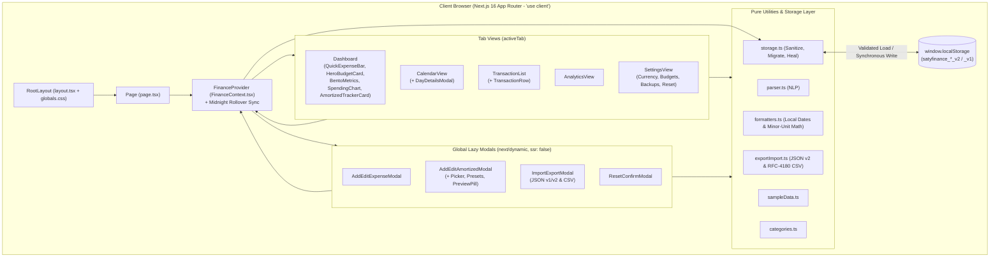
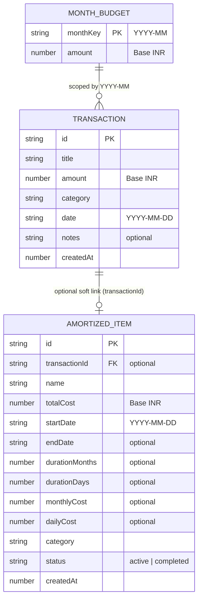
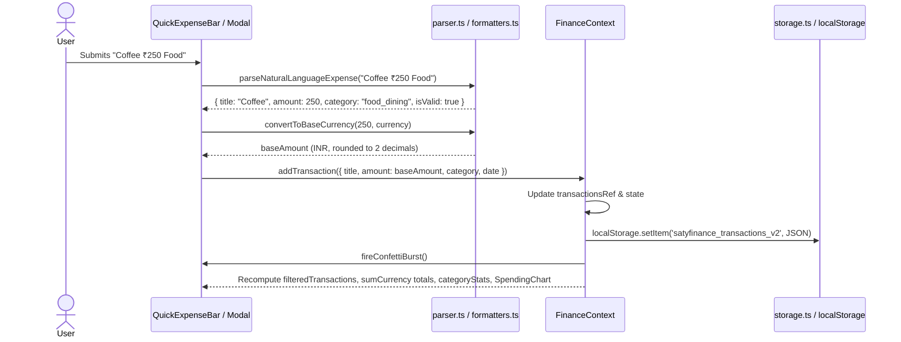

# MASTER PROJECT BLUEPRINT — Satyfinance (`satyfinance`)

> **Document Purpose:** Single source of truth for the entire **Satyfinance** (`Project-Finance`) codebase. Every architectural claim, file path, symbol name, data flow, verification result, and status entry in this document is derived directly from inspecting the repository source code and executing project verification tools. Areas with no implementation in the repository (e.g., backend servers, databases, authentication, external APIs) are explicitly documented as **Not Implemented / None** or **UNKNOWN** where future intent cannot be verified.

---

## Table of Contents

1. [Project Overview](#1-project-overview)
2. [Complete Folder Structure](#2-complete-folder-structure)
3. [Complete Technology Stack](#3-complete-technology-stack)
4. [Complete System Architecture](#4-complete-system-architecture)
5. [Complete Feature and Module Breakdown](#5-complete-feature-and-module-breakdown)
6. [Complete User Journey](#6-complete-user-journey)
7. [Backend and API Documentation](#7-backend-and-api-documentation)
8. [Complete Database Blueprint (Client Persistence Schema)](#8-complete-database-blueprint-client-persistence-schema)
9. [Frontend Blueprint](#9-frontend-blueprint)
10. [Authentication and Security](#10-authentication-and-security)
11. [External Integrations](#11-external-integrations)
12. [Actual Project Status](#12-actual-project-status)
13. [Bugs and Technical Debt](#13-bugs-and-technical-debt)
14. [Complete Data Flow](#14-complete-data-flow)
15. [Missing Features and Requirements](#15-missing-features-and-requirements)
16. [Development Roadmap](#16-development-roadmap)
17. [Important Technical Decisions](#17-important-technical-decisions)
18. [Complete CTO Summary](#18-complete-cto-summary)
19. [Audit Coverage & Verification Report](#19-audit-coverage--verification-report)
20. [Pre-GitHub Security, Privacy & Dependency Audit](#20-pre-github-security-privacy--dependency-audit)

---

## 1. Project Overview

- **Project Name:** Satyfinance (`satyfinance`, v0.1.0, MIT License, Author: Satyarth)
- **Project Purpose:** A privacy-first, local-first personal finance and wealth workspace web application for tracking daily expenses, monthly budgets, upcoming scheduled bills, spending analytics, and **product lifespan amortization** (spreading the cost of durable/consumable purchases across their useful life).
- **Business Objectives:**
  - Provide zero-friction expense logging via natural language input (e.g., `"Coffee ₹250 Food"`).
  - Separate **settled** expenses (on or before today) from **scheduled/upcoming** bills (future dates) within a monthly cashflow view.
  - Quantify true monthly and daily burn rates for multi-month purchases (e.g., skincare, supplements, electronics, fragrances) via Product Lifespan Amortization.
  - Ensure 100% browser-local privacy with no account registration or server-side financial data storage, paired with portable full-workspace JSON backups and RFC-4180 CSV import/export.
- **Problem Being Solved:** Traditional expense trackers treat a multi-month purchase as a single-day spike and require tedious multi-field forms. Satyfinance combines one-line NLP entry, calendar cashflow forecasting, multi-currency conversion over base INR storage, and lifespan amortization in a high-contrast editorial UI.
- **Target Audience:** Individual users (INR base currency with dynamic display conversion for USD, EUR, and GBP) seeking a fast, account-free personal expense and budget workspace.
- **Main Functionalities:**
  1. **Dashboard:** Quick NLP expense bar, Monthly Budget Hero Card (inline budget editing, settled vs. scheduled breakdown, utilization bar), 4 Bento KPIs, 7-bucket chronological Spending Activity stacked bar chart, and Product Lifespan Amortization tracker.
  2. **Calendar:** Monthly calendar grid showing daily settled spend, short-named scheduled bill badges, and a Day Details modal for per-day inspection, validation, and quick entry.
  3. **Transactions:** Month-scoped, searchable, category-filterable, and multi-criteria sortable ledger with inline lifespan-tracking triggers and synchronized edit/delete links.
  4. **Analytics:** Monthly KPIs (Largest/Smallest Entry, Most Frequent Category, Budget Used), proportional Spending Mix bar, Budget Burn Velocity, and sortable Category Details cards.
  5. **Settings & Data Portability:** Display Currency switcher (`INR`, `USD`, `EUR`, `GBP`), currency-aware monthly budget target editor with presets, full-workspace JSON export/restore, RFC-4180 CSV export/import, and sample-data/clear-all reset controls.
- **Current Development Stage:** Production-ready **v0.1.0 Client-Side Workspace** (targeted for zero-config Vercel deployment per `README.md`). Core UI, `localStorage` persistence/migration/recovery, currency conversion, backup/restore, automated Vitest test suite (`38` tests across `6` files), TypeScript strict checks, ESLint checks, and Next.js production build all pass.
- **Expected Final Outcome:** A reliable, privacy-first personal finance web app with accurate local-calendar calculations, resilient browser persistence, and full backup portability.

---

## 2. Complete Folder Structure

```text
Project-Finance/
├── .eslintrc.json                                  # Legacy ESLint 8 config retained from initial scaffold (superseded by eslint.config.mjs)
├── .gitignore                                      # Ignores node_modules, .next, out, build, coverage, .env, .env.* (!.env.example), keys/certs, DB/SQL dumps, backups, logs, .vercel, IDE/temp files
├── eslint.config.mjs                               # Active ESLint 9 flat config (eslint-config-next/core-web-vitals & typescript)
├── MASTER_PROJECT_BLUEPRINT.md                     # Single comprehensive project architecture & audit blueprint
├── next-env.d.ts                                   # Next.js TypeScript ambient declarations (auto-generated)
├── next.config.mjs                                 # Next.js config: reactStrictMode: true, poweredByHeader: false
├── package.json                                    # Dependencies & scripts (dev, fast, dev:fast, build, start, lint, test, test:watch)
├── package-lock.json                               # Locked npm dependency tree
├── postcss.config.mjs                              # PostCSS config enabling Tailwind CSS
├── README.md                                       # Project summary, features, privacy note, Vercel deployment note
├── tailwind.config.ts                              # Tailwind v3.4 config: custom CSS-var colors, fonts, sharp radii
├── tsconfig.json                                   # Strict TypeScript config (ES2017 target, react-jsx) with @/* -> ./src/* path alias
├── vitest.config.ts                                # Vitest config (jsdom, @vitejs/plugin-react, @/* alias)
├── vitest.setup.ts                                 # Testing Library jest-dom setup & canvas-confetti mock
└── src/
    ├── __tests__/
    │   ├── components.test.tsx                     # 7 component integration tests (Settings, DayDetails, PreviewPill, Tracker, ImportExport, AmortModal, Calendar)
    │   ├── exportImport.test.ts                    # 7 tests for v2 JSON backup, v1 backward compat, malformed input, and RFC-4180 CSV round-trip
    │   ├── FinanceContext.test.tsx                 # 4 integration tests (CRUD, precision, midnight rollover, linking, backup restore, clearAllData)
    │   ├── formatters.test.ts                      # 11 tests for currency rounding/conversion, local dates, DST/leap-year day diffs, sample clamping
    │   ├── parser.test.ts                          # 4 tests for NLP expense parsing, Indian/Western commas, currency tags, aliases
    │   └── storage.test.ts                         # 5 tests for clean init, safe ₹45,000 budget migration, corruption recovery, link healing
    ├── app/
    │   ├── fonts/
    │   │   ├── GeistMonoVF.woff                    # Local variable font for Geist Mono
    │   │   └── GeistVF.woff                        # Local variable font for Geist Sans
    │   ├── globals.css                             # Design tokens (:root), base resets, .sf-* editorial component classes
    │   ├── layout.tsx                              # Root HTML/Body layout, metadata, viewport, localFont + IBM Plex Mono
    │   └── page.tsx                                # Main entry ('use client'): FinanceProvider + MainDashboard + recovery notice + dynamic views/modals
    ├── constants/
    │   └── categories.ts                           # CATEGORIES, VALID_CATEGORY_IDS, CURRENCIES, VALID_CURRENCY_CODES, DEFAULT_MONTHLY_BUDGET, BUDGET_PRESETS_BY_CURRENCY
    ├── context/
    │   └── FinanceContext.tsx                      # Global React Context: state, ref-safe CRUD, midnight todayDateStr sync, analytics, backup restore
    ├── types/
    │   └── finance.ts                              # TypeScript contracts: CategoryId, Transaction, CurrencyCode, ViewTab, SortOption, MonthKey, AmortizedItem, SatyfinanceBackup, ImportedBackupData
    ├── utils/
    │   ├── confetti.ts                             # fireConfettiBurst() wrapper around canvas-confetti with SSR guard
    │   ├── exportImport.ts                         # createBackupPayload, exportToJSON, exportToCSV, parseImportedJSON, parseImportedCSV
    │   ├── formatters.ts                           # roundCurrency, sumCurrency, formatCurrency, formatDisplayAmount, currency converters, local ISO date utilities
    │   ├── id.ts                                   # generateId('tx' | 'amort')
    │   ├── parser.ts                               # parseNaturalLanguageExpense() NLP engine
    │   ├── sampleData.ts                           # getSampleDateStr(), generateSampleTransactions(), generateSampleAmortizedItems()
    │   └── storage.ts                              # Storage key constants, record sanitizers, loadAndMigrateStorage(), orphaned link healing
    └── components/
        ├── analytics/
        │   └── AnalyticsView.tsx                   # Analytics tab: 4 KPI cards, Spending Mix bar, Budget gauge, sortable Category Details
        ├── calendar/
        │   ├── CalendarView.tsx                    # Calendar tab: 7-column monthly grid, settled vs scheduled bill badges, month-synced selection
        │   └── DayDetailsModal.tsx                 # Modal for inspecting/editing/deleting transactions on a date + validated quick-add
        ├── common/
        │   ├── CategoryBadge.tsx                   # Category pill or icon-only badge
        │   └── CategoryIcon.tsx                    # Maps CategoryId to @tabler/icons-react icon
        ├── dashboard/
        │   ├── AmortizedTrackerCard.tsx            # Dashboard Product Lifespan grid, UTC-safe remaining-day calc, confirm-guarded delete
        │   ├── BentoMetrics.tsx                    # 4-card KPI grid (Settled, Scheduled, Daily Avg, Top Cat)
        │   ├── HeroBudgetCard.tsx                  # Monthly spend hero, inline budget editor, utilization bar
        │   ├── QuickExpenseBar.tsx                 # NLP quick-add bar ('/' or 'Cmd/Ctrl+K') with currency-aware preview
        │   └── SpendingChart.tsx                   # 7-bucket stacked bar chart (Settled vs Scheduled) with hover tooltips
        ├── layout/
        │   ├── Header.tsx                          # Sticky top bar: month switcher, month/year picker popover, Add Expense CTA ('N')
        │   ├── MobileNav.tsx                       # MobileNav slide-out drawer + fixed MobileBottomBar
        │   └── Sidebar.tsx                         # Desktop sticky left sidebar (5 tabs + Satyarth footer)
        ├── modals/
        │   ├── AddEditAmortizedModal.tsx           # Modal to create/edit AmortizedItem (prevents duplicate tx links, supports unlinking)
        │   ├── AddEditExpenseModal.tsx             # Modal to create/edit Transaction with strict date & amount validation
        │   ├── ImportExportModal.tsx               # Modal for full JSON/CSV export and validated JSON/CSV import with merge/replace preview
        │   ├── ResetConfirmModal.tsx               # Confirmation dialog for loading sample data or clearing all workspace records
        │   └── amortized/
        │       ├── AmortizedDurationPresets.tsx    # Duration preset chips (1m, 2m, 3m, 6m, 1yr, Ongoing, Custom)
        │       ├── AmortizedExpensePicker.tsx      # Searchable/filterable existing transaction picker ("Edit" for tracked, "Select" for untracked)
        │       └── AmortizedPreviewPill.tsx        # Live monthly/daily amortized cost preview pill using formatDisplayAmount
        ├── settings/
        │   └── SettingsView.tsx                    # Settings tab: Display Currency selector, Monthly Budget Target + presets, Data & Backups, Storage & Reset
        └── transactions/
            ├── TransactionList.tsx                 # Transactions tab: summary cards, search, category pills, sort, transaction-ID-first amortized lookup
            └── TransactionRow.tsx                  # Individual transaction row with lifespan badge and edit/delete/track actions
```

### Entry Points & File Dependencies
- **Application Entry Points:**
  - [src/app/layout.tsx](src/app/layout.tsx): Next.js `RootLayout` loading local fonts (`GeistVF.woff`, `GeistMonoVF.woff`), `@fontsource/ibm-plex-mono`, and [src/app/globals.css](src/app/globals.css).
  - [src/app/page.tsx](src/app/page.tsx): Client-side root page (`'use client'`) wrapping `<MainDashboard />` inside `<FinanceProvider>`.
- **Unused / Duplicate Files:**
  - Every source file under `src/` is imported by active application modules or executed via `src/__tests__/`. No duplicate utilities or orphaned modules remain.

---

## 3. Complete Technology Stack

| Layer | Technology | Version / Config | Where & Why Used |
|---|---|---|---|
| **Framework** | Next.js (App Router) | `^16.4.6` (`16.4.6`, Turbopack) | Application shell, bundling, `next/font/local`, `next/dynamic` code splitting, static optimization, Vercel deployment target. |
| **UI Library** | React / React DOM | `^18` (`18.3.1`) | Component rendering, hooks (`useSyncExternalStore`, `useState`, `useEffect`), Context API state management. |
| **Language** | TypeScript | `^5` (`strict: true`, `target: ES2017`) | Static typing for financial entities, backup payloads, component props, and context contracts (`@types/node@^24.19.4`). |
| **Styling** | Tailwind CSS + PostCSS | `^3.4.1` / `^8.5.34` | Responsive grid/flex layout; custom CSS variables & `.sf-*` editorial surface classes in `src/app/globals.css`. |
| **Icons** | `@tabler/icons-react` | `^3.46.0` | Stroke icons across navigation, KPI cards, modals, and expense categories. |
| **Typography** | Geist VF + IBM Plex Mono | Local `.woff` + `@fontsource/ibm-plex-mono` `^5.3.0` | Editorial sans-serif headings/body paired with `tabular-nums` monospace for financial alignment. |
| **Effects** | `canvas-confetti` | `^1.9.4` | Subtle grayscale confetti celebration burst on creating or importing expenses/products. |
| **Persistence** | Browser `localStorage` | Web Storage API | Client-only persistence for transactions, budgets, currency preference, amortized items, and migration state. |
| **Testing** | Vitest + Testing Library + jsdom | `vitest@^5.1.2`, `@vitejs/plugin-react@^5.2.0`, `@testing-library/react@^16.3.3` | Automated unit and React component integration tests (`npm test`). |
| **Linting** | ESLint | `^9.39.5` (`eslint-config-next@^16.4.6` flat config in `eslint.config.mjs`) | Static code quality and React Hook rules verification (`npm run lint` runs `eslint .`). |
| **Hosting** | Vercel (documented) | Zero-config Next.js (`README.md`) | Production deployment platform (no custom `vercel.json` required). |
| **Backend / DB / Auth** | **None** | N/A | Intentionally omitted to preserve 100% browser-local privacy. |

---

## 4. Complete System Architecture

Satyfinance is a **single-page, client-only React application** served by Next.js. There is no backend server, no HTTP API layer, no remote database, and no authentication service.

- **Frontend Architecture:**
  - `RootLayout` (`src/app/layout.tsx`) outputs static HTML, viewport metadata, font variables, and `globals.css`.
  - `Page` (`src/app/page.tsx`) mounts `FinanceProvider` and `MainDashboard` as `'use client'`.
  - Secondary tab views (`CalendarView`, `TransactionList`, `AnalyticsView`, `SettingsView`) and all 4 global modals (`AddEditExpenseModal`, `AddEditAmortizedModal`, `ImportExportModal`, `ResetConfirmModal`) are code-split via `next/dynamic(..., { ssr: false })`.
- **State, Persistence & Midnight-Sync Architecture:**
  - `FinanceContext` (`src/context/FinanceContext.tsx`) separates SSR pre-hydration (`StaticFinanceProvider` via `useSyncExternalStore`) from mounted browser persistence (`HydratedFinanceProvider`) backed by ref-synchronized arrays/maps (`transactionsRef`, `amortizedRef`, `budgetsRef`) to prevent stale-closure data loss during rapid consecutive updates.
  - On client mount, `HydratedFinanceProvider` initializes state via `inspectStorageSnapshot()` (`src/utils/storage.ts`) to parse, validate, recover from corrupt JSON, prepare safe legacy demo migration, and heal orphaned `transactionId` references, flushing any `pendingWrites` to `localStorage` inside `useEffect` (`loadAndMigrateStorage()` wraps both steps for tests/imperative callers).
  - A midnight timer plus `window.focus` and `document.visibilitychange` listeners automatically advance `todayDateStr`, keeping `settled` vs. `scheduled` classification and elapsed days accurate even if a tab stays open past midnight.
  - All monetary storage uses **base INR (`INR`)** rounded to 2 decimal places (`roundCurrency`) and summed in integer minor units (`sumCurrency`) to prevent IEEE-754 floating-point drift.



---

## 5. Complete Feature and Module Breakdown

### 5.1 Global State, Storage Sanitization & Midnight Sync (`src/context/FinanceContext.tsx`, `src/utils/storage.ts`)
- **Purpose:** Centralizes financial records, safe `localStorage` persistence, corruption recovery, month scoping, currency conversion, derived KPIs, and transaction-to-amortized synchronization.
- **How it Works:**
  - `inspectStorageSnapshot()` reads the 5 `localStorage` keys cleanly on client initialization (`HydratedFinanceProvider`), validates every transaction, amortized item, budget month-key/amount, and currency code, flags `hadCorruptData` (surfaced as a dismissible recovery banner in `page.tsx`), clears legacy sample entries only when the workspace contained solely canonical sample IDs (`tx-01`..`tx-19`), clears dangling `transactionId` references without deleting products, and returns `pendingWrites` flushed in `useEffect` (`loadAndMigrateStorage()` executes both steps imperatively).
  - `todayDateStr` is maintained in state and refreshed at local midnight + `focus`/`visibilitychange`.
- **Business Rules:**
  - Past months: all transactions are `settled`.
  - Current month: `t.date <= todayDateStr` is `settled`; `t.date > todayDateStr` is `scheduled`.
  - Future months: all transactions are `scheduled`.
  - `dailySpendAverage`: `roundCurrency(settledSpentThisMonth / elapsedDaysThisMonth)` (current month), `roundCurrency(totalSpentThisMonth / elapsedDaysThisMonth)` (past month), `0` (future month).
- **Status:** **Completed & Tested** (`storage.test.ts`, `FinanceContext.test.tsx`).

### 5.2 Natural Language Quick Expense Bar (`src/components/dashboard/QuickExpenseBar.tsx`, `src/utils/parser.ts`)
- **Purpose:** One-line expense entry with live NLP preview and keyboard shortcuts (`/` or `Cmd/Ctrl+K`).
- **How it Works:** `parseNaturalLanguageExpense(input)` runs in 3 stages:
  1. **Amount Extraction:** Matches explicit currency-tagged numbers first (`₹`, `$`, `€`, `£`, `rs`, `inr`, `usd`, `eur`, `gbp`, `bucks`) supporting both Indian (`1,25,000`) and Western (`1,250.50`) comma grouping; otherwise scans all numbers and picks the highest numeric value.
  2. **Category Detection:** Checks `CATEGORY_ALIASES` (multi-word and explicit category tags, stripping only category tags so item words like `Dinner` or `Lunch` stay in the title) and falls back to `CATEGORIES[id].keywords`.
  3. **Title Formatting:** Strips punctuation, normalizes whitespace, and Title-Cases words (falling back to `"<Category> Expense"` or `"Expense"`).
- **Date Rule:** Logs to `todayDateStr` when viewing the current month, or `${selectedMonth.key}-01` for past/future months.
- **Status:** **Completed & Tested** (`parser.test.ts`).

### 5.3 Monthly Budget Hero & Bento Metrics (`HeroBudgetCard.tsx`, `BentoMetrics.tsx`)
- **Purpose:** Displays monthly total outflow, settled vs. scheduled breakdown, budget headroom, inline budget editing, and 4 Bento KPIs (`SETTLED`, `SCHEDULED`, `DAILY AVG`, `TOP CAT`).
- **Business Rules:** Unset months (`currentBudget === 0`) display `"Set target"` / `"No target"` without mutating `monthlyBudgets` if the user blurs the inline editor unchanged at `0`. Over-budget states render in red (`#A33B27` / `bg-red-50`).
- **Status:** **Completed**.

### 5.4 Spending Activity Chart (`src/components/dashboard/SpendingChart.tsx`)
- **Purpose:** Chronological stacked bar chart partitioning `1..daysInMonth` into 7 intervals.
- **How it Works:** Uses `todayDateStr` / `parseLocalDate` from `useFinance()` and `sumCurrency()` per bucket, rendering settled (`#1B1A18`) and scheduled (`#DED9D2`) stacked bars with hover tooltips and a terracotta highlight ring (`ring-[1.5px]`) on the current bucket.
- **Status:** **Completed**.

### 5.5 Product Lifespan Amortization (`AmortizedTrackerCard.tsx`, `AddEditAmortizedModal.tsx`, `src/components/modals/amortized/*`)
- **Purpose:** Spreads purchase costs over product lifespan (`durationMonths`, `durationDays`, `monthlyCost`, `dailyCost`).
- **How it Works:**
  - Users can pick an existing expense (`AmortizedExpensePicker`) or enter a custom product (`1 mo`, `2 mo`, `3 mo`, `6 mo`, `1 yr`, `Ongoing`, `Custom` presets).
  - Selecting an already-tracked transaction switches directly into editing the existing `AmortizedItem` (preventing duplicate `transactionId` entries). Users can also unlink an item via the `"Unlink"` button.
  - `AmortizedPreviewPill` uses `formatDisplayAmount()` so non-INR currency previews display accurately without double conversion.
  - `AmortizedTrackerCard` uses local calendar `Date.UTC` day math for remaining days and requires `window.confirm` before deletion.
  - Editing a linked `Transaction` automatically updates `name`, `totalCost`, `category`, `startDate`, shifted `endDate`, `monthlyCost`, `dailyCost`, and `status`; deleting a linked `Transaction` cleanly removes `transactionId`.
- **Status:** **Completed & Tested** (`FinanceContext.test.tsx`, `components.test.tsx`).

### 5.6 Calendar Forecasting (`CalendarView.tsx`, `DayDetailsModal.tsx`)
- **Purpose:** 7-column monthly cashflow calendar showing settled daily totals and future scheduled bill badges (`getBillShortName`).
- **How it Works:** `CalendarView` synchronizes `today` via `useMemo` from `todayDateStr` and keeps `selectedDay` valid when switching months. Clicking a current-month day opens `DayDetailsModal`, which validates quick-add inputs with explicit inline error banners (`"Enter a description."`, `"Enter a valid amount greater than 0."`) and resets stale form state when `dateString` changes.
- **Status:** **Completed & Tested** (`components.test.tsx`).

### 5.7 Transactions Ledger (`TransactionList.tsx`, `TransactionRow.tsx`)
- **Purpose:** Month-scoped search (title + notes), category filter pills with live counts, and 5 sort options (`date-desc` / `date-asc` via `compareISODates`, `amount-desc`, `amount-asc`, `title-asc`).
- **Amortized Lookup:** Matches strictly by `item.transactionId` first, falling back only for unlinked legacy items (`!item.transactionId`).
- **Status:** **Completed**.

### 5.8 Analytics (`AnalyticsView.tsx`)
- **Purpose:** Month-scoped insights: Largest Entry, Smallest Entry, Most Frequent Category, Budget Used %, Proportional Spending Mix bar, Budget gauge (`Spent`, `Remaining`/`Deficit`, `Budget`), and sortable Category Details cards.
- **Status:** **Completed**.

### 5.9 Settings, Currency, Backup & Reset (`SettingsView.tsx`, `ImportExportModal.tsx`, `ResetConfirmModal.tsx`, `exportImport.ts`)
- **Purpose:**
  - **Display Currency:** Interactive 4-currency selector (`INR`, `USD`, `EUR`, `GBP`) updating display formatting without altering underlying base INR values.
  - **Monthly Budget Target:** Currency-aware input, daily budget hint, inline validation, and currency-specific quick presets (`BUDGET_PRESETS_BY_CURRENCY`).
  - **Data & Backups:** Complete v2 JSON backup export (`transactions`, `amortizedItems`, `monthlyBudgets`, `currency`) and RFC-4180 CSV transaction export; validated `.json` (v2, v1 array, v1 object) and `.csv` import with skipped-row warnings, preview, Merge (non-destructive default), and warned Replace mode.
  - **Storage & Reset:** Reload sample data or permanently clear all transactions, budgets, amortized items, and reset currency to `'INR'` behind `ResetConfirmModal`.
- **Status:** **Completed & Tested** (`exportImport.test.ts`, `components.test.tsx`, `FinanceContext.test.tsx`).

---

## 6. Complete User Journey

Every user flow executes synchronously in the client browser:

1. **Quick NLP Expense Entry:**
   `User types "Coffee ₹250 Food" & submits` → `QuickExpenseBar` calls `parseNaturalLanguageExpense()` → `convertToBaseCurrency()` → `FinanceContext.addTransaction()` → updates `transactionsRef` & React state, writes `satyfinance_transactions_v2`, fires `fireConfettiBurst()` → derived KPIs, charts, calendar, and analytics recompute immediately.
2. **Modal Expense Create / Edit / Delete:**
   `User clicks "+ Add expense" (or presses 'N')` → `AddEditExpenseModal` validates description, finite amount > 0, and `isValidISODate(date)` → `addTransaction()` or `updateTransaction()` (which also syncs any linked `AmortizedItem`) → persists to `localStorage`. Deleting via `TransactionRow` or `DayDetailsModal` prompts `window.confirm`, removes the transaction, and unlinks any referencing `AmortizedItem`.
3. **Product Lifespan Amortization:**
   `User clicks "Add product" or hourglass icon` → `AddEditAmortizedModal` selects an untracked expense (or switches to edit mode if already tracked) or accepts custom input → validates start/end dates locally (`compareISODates`) → computes `monthlyCost` and `dailyCost` from base INR → `addAmortizedItem()` / `updateAmortizedItem()` → writes `satyfinance_amortized_v2`.
4. **Calendar Day Inspection:**
   `User opens Calendar & clicks a day cell` → `CalendarView` opens `DayDetailsModal` → displays day transactions and total (`sumCurrency`) → quick-add validates inputs with inline errors and logs directly to that date.
5. **Currency Switching:**
   `User opens Settings & clicks USD/EUR/GBP/INR` → `setCurrency()` updates `satyfinance_currency_v2` → all views convert stored INR values dynamically on render without modifying stored transaction/budget records.
6. **Full Backup Export / Import & Clear All:**
   `User opens Import/Export` → `exportToJSON()` writes v2 `SatyfinanceBackup`; `exportToCSV()` writes RFC-4180 CSV. Uploading `.json` or `.csv` triggers `parseImportedJSON()` / `parseImportedCSV()` → shows validation counts/warnings + preview → `importBackup(backup, replaceExisting)` merges without overwriting existing budgets/items, or replaces scoped sections with an explicit warning. `Clear All Records` opens `ResetConfirmModal` and clears transactions, budgets, amortized items, and currency preference.

**User Roles & Permissions:** Single-user local browser workspace; no authentication, roles, or multi-tenant permissions exist.

---

## 7. Backend and API Documentation

- **Backend Implementation:** **None.** There is no `src/app/api/` directory, no Next.js Server Actions (`'use server'`), no backend server process, and no `fetch()` / HTTP API calls in `src/`.
- **Endpoints / Controllers / Services / Middleware:** None.

---

## 8. Complete Database Blueprint (Client Persistence Schema)

Persistence uses **5 `localStorage` keys** managed by `src/utils/storage.ts` and `src/context/FinanceContext.tsx`:

| `localStorage` Key | Data Structure | Default on Clean Start | Notes |
|---|---|---|---|
| `satyfinance_transactions_v2` | `Transaction[]` (JSON) | `[]` | Expense records; amounts in base `INR` rounded to 2 decimals. |
| `satyfinance_amortized_v2` | `AmortizedItem[]` (JSON) | `[]` | Product lifespan records; costs in base `INR`. |
| `satyfinance_budgets_v2` | `Record<string, number>` (JSON) | `{}` | Map of valid `"YYYY-MM"` keys to non-negative monthly budgets in base `INR`. |
| `satyfinance_currency_v2` | `'INR' \| 'USD' \| 'EUR' \| 'GBP'` | `'INR'` | Active display currency code (removed on `clearAllData()`). |
| `satyfinance_demo_cleared_v1` | `'1'` | `'1'` (after initial load) | One-time legacy sample-data migration completion flag. |

### Entity Schemas (`src/types/finance.ts`)

- **`Transaction`**: `id` (`tx-...`), `title`, `amount` (INR), `category` (`CategoryId`), `date` (`YYYY-MM-DD`), `notes?`, `createdAt` (epoch ms).
- **`AmortizedItem`**: `id` (`amort-...`), `transactionId?` (soft FK → `Transaction.id`), `name`, `totalCost` (INR), `startDate` (`YYYY-MM-DD`), `endDate?` (`YYYY-MM-DD`), `durationMonths?`, `durationDays?`, `monthlyCost?`, `dailyCost?`, `category`, `notes?`, `status` (`'active' | 'completed'`), `createdAt`.
- **`SatyfinanceBackup` (v2 JSON schema)**: `version: 2`, `app: 'satyfinance'`, `exportedAt`, `transactions`, `amortizedItems`, `monthlyBudgets`, `currency`.



---

## 9. Frontend Blueprint

- **Routing:** Single route `/` (`src/app/page.tsx`). Switching between the 5 views (`dashboard`, `calendar`, `transactions`, `analytics`, `settings`) uses `activeTab` state in `FinanceContext` (no URL route changes).
- **Layout & Navigation:**
  - Desktop (`md+`): Sticky left `Sidebar` (`w-64`) + sticky `Header` (month switcher + month/year popover + `+ Add expense` shortcut `N`).
  - Mobile (`<md`): Hamburger menu → `MobileNav` slide-out drawer (all 5 tabs + Add Expense + Import/Export) + fixed `MobileBottomBar` (4 main tabs + `+` button).
- **Design System (`src/app/globals.css` & `tailwind.config.ts`):**
  - Editorial high-contrast light aesthetic: `#FFFFFF` canvas, `#F7F5F2` paper cards, `#DED9D2` 1px borders, `#1B1A18` ink, `#E65B3F` terracotta accent, `0px`–`2px` radii, flat zero-shadow surfaces.
- **Loading, Recovery & Error States:**
  - Startup corruption recovery banner in `src/app/page.tsx` (`storageRecoveryNotice`).
  - Inline validation banners in `AddEditExpenseModal`, `AddEditAmortizedModal`, `DayDetailsModal`, `SettingsView`, and `ImportExportModal`.
  - Empty states in `MainDashboard`, `SpendingChart`, `AmortizedTrackerCard`, `DayDetailsModal`, `TransactionList`, `AnalyticsView`, and `AmortizedExpensePicker`.

---

## 10. Authentication and Security

- **Authentication / Sessions / JWT:** **None.** All records are stored locally in the browser; no accounts exist.
- **Data Protection & Input Validation:**
  - All `localStorage` payloads and uploaded JSON/CSV backups pass strict runtime validation (`sanitizeTransactions`, `sanitizeAmortizedItems`, `sanitizeMonthlyBudgets`, `isValidISODate`, `isValidMonthKey`, `isValidCategoryId`, `isValidCurrencyCode`).
  - `exportToCSV` escapes inner double quotes (`""`) per RFC-4180; `parseImportedCSV` rejects unclosed quotes, missing required headers, non-positive amounts, and invalid dates.
  - No `dangerouslySetInnerHTML`, `eval`, or external network calls exist in `src/`.
- **Security Considerations:**
  - `localStorage` is accessible to same-origin scripts (inherent browser storage model).
  - No secrets, API keys, or credentials exist anywhere in the repository.

---

## 11. External Integrations

**None.** No external APIs, webhooks, analytics trackers, or cloud backends are used. Currency rates in `CURRENCIES` (`src/constants/categories.ts`: `USD: 0.012`, `EUR: 0.011`, `GBP: 0.0094` against `INR`) are static reference rates.

---

## 12. Actual Project Status

| Module | Status | Verified Evidence | Remaining Work |
|---|---|---|---|
| **Core State, Storage & Migration** | **Completed & Tested** | `src/context/FinanceContext.tsx`, `src/utils/storage.ts`, `src/__tests__/storage.test.ts`, `src/__tests__/FinanceContext.test.tsx` | None blocking. |
| **Date, Timezone & Precision Utils** | **Completed & Tested** | `src/utils/formatters.ts`, `src/__tests__/formatters.test.ts` (tested in local, `Asia/Kolkata`, `America/New_York`) | None blocking. |
| **NLP Expense Parser** | **Completed & Tested** | `src/utils/parser.ts`, `src/components/dashboard/QuickExpenseBar.tsx`, `src/__tests__/parser.test.ts` | None blocking. |
| **Dashboard & Charts** | **Completed & Tested** | `HeroBudgetCard.tsx`, `BentoMetrics.tsx`, `SpendingChart.tsx`, `AmortizedTrackerCard.tsx` | Live browser visual QA pending Chrome debugging. |
| **Product Lifespan Amortization** | **Completed & Tested** | `AddEditAmortizedModal.tsx`, `src/components/modals/amortized/*`, `src/__tests__/components.test.tsx` | Live browser visual QA pending Chrome debugging. |
| **Calendar & Day Details** | **Completed & Tested** | `CalendarView.tsx`, `DayDetailsModal.tsx`, `src/__tests__/components.test.tsx` | Live browser visual QA pending Chrome debugging. |
| **Transactions Ledger** | **Completed** | `TransactionList.tsx`, `TransactionRow.tsx` | Unit/component test coverage can be expanded for sort/filter edge cases. |
| **Analytics View** | **Completed** | `src/components/analytics/AnalyticsView.tsx` | Component tests for Analytics rendering can be added optionally. |
| **Settings & Display Currency** | **Completed & Tested** | `src/components/settings/SettingsView.tsx`, `src/__tests__/components.test.tsx` | Optional: live exchange-rate lookup (out of scope for offline-first design). |
| **JSON & CSV Backup/Restore** | **Completed & Tested** | `src/utils/exportImport.ts`, `ImportExportModal.tsx`, `src/__tests__/exportImport.test.ts` | None blocking. |
| **Automated Test Suite** | **Completed (`38/38` Passing)** | `vitest.config.ts`, `src/__tests__/*.test.{ts,tsx}` | Optional: add Playwright E2E tests in CI. |
| **Backend / Auth / Cloud Sync** | **Not Applicable / None** | No `src/app/api/`, no DB, `README.md` | Only needed if product shifts away from local-only privacy. |

---

## 13. Bugs and Technical Debt

- **Resolved in Current Cycle (No Longer Open):**
  - Missing currency selector & hardcoded `₹` in `SettingsView.tsx` — **Fixed**.
  - Double currency conversion in `AmortizedPreviewPill.tsx` — **Fixed**.
  - Incomplete JSON export/import (`amortizedItems`, `monthlyBudgets`, `currency`) and missing CSV import — **Fixed**.
  - Incomplete `clearAllData()` leaving budgets and currency in `localStorage` — **Fixed**.
  - UTC vs. local date parsing drift (`new Date("YYYY-MM-DD")`), month-end overflow (`addMonthsToDate`), and `sampleData.ts` date overflow — **Fixed**.
  - Migration deleting legitimate `45000` user budgets — **Fixed**.
  - Stale `today` across midnight — **Fixed**.
  - Orphaned `transactionId` links, desynced edits, and duplicate amortized linking — **Fixed**.
  - Silent quick-add failure in `DayDetailsModal.tsx`, unconfirmed delete in `AmortizedTrackerCard.tsx`, invalid Tailwind utility classes (`h-8.5`, `w-8.5`, `h-6.5`, `py-0.2`, `sm:p-4.5`, `ring-1.5`), and missing automated test suite — **Fixed**.
- **Remaining Low-Severity Technical Debt / Design Constraints:**
  1. **React 18 Upgrade Path for Next.js 17 (`package.json`):** React `^18` (`18.3.1`) was intentionally preserved during the Next.js `16.4.6` security upgrade; `next build` emits an informational warning that React 18 support will be removed in Next.js 17.
  2. **Legacy `.eslintrc.json` Retained:** ESLint 9 (`eslint@^9.39.5`) actively uses `eslint.config.mjs`; `.eslintrc.json` remains on disk from the initial scaffold and can be removed whenever desired.
  3. **Static Exchange Rates (`src/constants/categories.ts`):** `USD`/`EUR`/`GBP` conversion factors are hardcoded static approximations; users cannot customize rates.
  4. **CSV Export Formula Characters (`src/utils/exportImport.ts`):** CSV fields are RFC-4180 quoted, though cells beginning with `=`, `+`, `-`, `@` are preserved verbatim for exact CSV round-trip compatibility rather than neutralized with a leading apostrophe.
  5. **Unused `darkMode: 'class'` in `tailwind.config.ts`:** `src/app/globals.css` enforces light mode (`color-scheme: light !important`).
  6. **In-Memory Tab Navigation:** Tabs do not sync to URL search/hash parameters (browser Back button does not switch tabs).
  7. **Live Browser E2E Unexecuted:** Live Chrome DevTools rendering/responsive verification could not run in this environment because Chrome remote debugging (`DevToolsActivePort`) was unavailable; UI tests currently rely on jsdom + React Testing Library (`38/38` passing under Vitest `5.1.2`) and `next build` (`16.4.6`).

---

## 14. Complete Data Flow



---

## 15. Missing Features and Requirements

- **Confirmed Missing vs. Broader Finance Product Scope (Intentional per `README.md`):**
  - User accounts / authentication, cloud database sync, automated bank-feed imports.
- **Confirmed Missing Operational Coverage:**
  - Live Chrome/Playwright E2E browser suite in CI (only Vitest + jsdom integration tests currently exist).
- **UNKNOWN (Cannot Be Verified from Repository):**
  - Whether custom exchange rate editing, dark mode UI support, recurring bill auto-generation across months, or PWA offline manifest/service-worker caching are planned for future releases.

---

## 16. Development Roadmap

| Priority | Task | Dependencies | Acceptance Criteria |
|---|---|---|---|
| **P1 (High)** | Execute live Chrome / mobile-device QA before production deploy | Running server (`npm run start`) + Chrome / Playwright | Zero console errors; zero horizontal overflow across `1440px`, `768px`, `390px`; visual confirmation of all modals & tabs. |
| **P2 (Medium)** | Add Playwright E2E suite in CI | `@playwright/test` | Automated headless Chromium flows pass for NLP add, calendar, amortization, currency switch, and backup round-trip. |
| **P2 (Medium)** | Expand component test coverage for `AnalyticsView`, `TransactionList`, `SpendingChart`, `HeroBudgetCard` | Vitest + Testing Library | Tests assert sorting, filtering, chart bucketing, and over-budget styling. |
| **P3 (Low)** | Sync `activeTab` with URL hash/query param (`?tab=calendar`) | `FinanceContext` / `page.tsx` | Browser Back/Forward navigates tabs and deep-linking works without breaking static export. |
| **P3 (Low)** | Optional customizable exchange rates in Settings or opt-in CSV formula prefix toggle | `SettingsView.tsx`, `exportImport.ts` | Users can adjust conversion rates in `localStorage` without altering base INR records. |

---

## 17. Important Technical Decisions

- **Base Currency Storage (`INR`):** All persisted amounts (`Transaction.amount`, `AmortizedItem.totalCost`, `monthlyBudgets`) are stored in INR and converted dynamically for display via `CURRENCIES[code].rateAgainstINR`. Changing `rateAgainstINR` retroactively alters displayed figures for non-INR users.
- **Minor-Unit Summation & 2-Decimal Rounding (`formatters.ts`):** `sumCurrency` accumulates `Math.round(v * 100)` before dividing by `100`, preventing floating-point artifacts across dashboard/analytics totals.
- **Local Calendar Date Space (`formatters.ts`):** All `YYYY-MM-DD` dates parse via `parseLocalDate` (`new Date(y, m - 1, d)`) rather than `new Date(isoStr)` (UTC midnight), while day differences use `Date.UTC(y, m - 1, d)` to remain invariant across DST and non-UTC timezones.
- **Hydration-Safe Context & Ref-Synchronized Mutations (`FinanceContext.tsx`):** `FinanceProvider` uses `useSyncExternalStore` to render `StaticFinanceProvider` on SSR/initial hydration and `HydratedFinanceProvider` once mounted, reading `inspectStorageSnapshot()` lazily and flushing `pendingWrites` cleanly in `useEffect` (no `setState` in `useEffect` under ESLint 9 React Hook rules). `transactionsRef`, `amortizedRef`, and `budgetsRef` prevent stale closures during rapid consecutive mutations.
- **Keyed Form Resets Without Effect Cascades:** Modals (`AddEditExpenseModal`, `AddEditAmortizedModal`, `DayDetailsModal`) and inline state (`Header`, `HeroBudgetCard`, `CalendarView`, `SettingsView`) avoid synchronous `setState` inside `useEffect` via keyed inner wrappers, event-driven state updates, or state keys.
- **Editorial Light Design System (`globals.css`):** `!important` surface tokens and `color-scheme: light !important` lock the light paper aesthetic; do not introduce `dark:` classes without revising `globals.css` first.
- **Dynamic Client Splitting (`page.tsx`):** Secondary views and modals load via `next/dynamic(..., { ssr: false })` to avoid SSR/hydration mismatches with `localStorage` and `Date`.

---

## 18. Complete CTO Summary

1. **What exactly is this project?** **Satyfinance** (`satyfinance` v0.1.0), a client-only Next.js 16 (App Router) personal finance dashboard featuring NLP quick-add, monthly budgeting, calendar cashflow forecasting, spending analytics, and product lifespan amortization.
2. **How does it work?** All mutable state lives in `FinanceContext`, synchronized to `localStorage` through `src/utils/storage.ts`. Amounts persist in base INR and convert dynamically into `INR`, `USD`, `EUR`, or `GBP`.
3. **How is everything connected?** `src/app/page.tsx` wraps `MainDashboard` in `FinanceProvider`. All 5 views (`Dashboard`, `Calendar`, `Transactions`, `Analytics`, `Settings`) and 4 lazy modals communicate exclusively via `useFinance()`.
4. **What is currently operational?** Full expense CRUD, NLP quick-add, inline/settings budgeting, 4-currency switching, product lifespan amortization with transaction linking, calendar forecasting + validated day quick-add, transaction search/filter/sort, analytics breakdown, v2 full JSON & RFC-4180 CSV backup/restore, and full `Clear All Records`.
5. **What is completed?** Core UI, state/storage engine, corruption recovery, safe migration, local calendar math, midnight rollover, ESLint 9 React Hook compliance, zero-vulnerability dependency upgrades (`next@16.4.6`, `vitest@^5.1.2`, `eslint@^9.39.5`, `postcss@^8.5.34`), `.gitignore` hardening, automated Vitest suite (`38` tests), TypeScript strict check, ESLint, and Next.js production build.
6. **What is incomplete?** Live interactive Chrome DevTools / Playwright E2E verification across physical/real browser viewports.
7. **What is broken?** No known broken functionality in source code or automated checks (`38/38` tests, `tsc`, `eslint .`, `next build`, and `npm audit` all pass with zero errors/vulnerabilities).
8. **What is currently under development?** Pre-push Git review and optional live browser smoke testing.
9. **What is still required?** Configure repo-local git `user.email` to a GitHub noreply address before creating new commits, inspect `git status`/`git diff`, commit/push when ready, and optionally verify live UI responsiveness in Chrome.
10. **What are the biggest risks?** Browser site-data clearing (mitigated by full v2 JSON backup export/restore), static currency rates in `CURRENCIES`, React 18 deprecation ahead of a future Next.js 17 upgrade, and unverified real-browser layout rendering until Chrome/Playwright QA runs.
11. **What should be the next development priorities?** (1) Complete live Chrome/Playwright responsive & interactive walkthrough; (2) Add CI automation running `npm audit --omit=dev`, `npm test`, `npm run lint`, and `npm run build` on PRs; (3) Plan React 19 upgrade before adopting Next.js 17, plus optional URL-synced tabs and customizable currency rates.

---

## 19. Audit Coverage & Verification Report

- **Files Scanned & Audited:** `60` non-build/non-dependency workspace files (`56` scanned source/config/test/blueprint text files, `package-lock.json`, `2` binary `.woff` fonts, and `tsconfig.tsbuildinfo`; plus `.vscode/settings.json` gitignored), all `9` Git commits (`git log --all`), and `592` entries in `package-lock.json` (`484` installed packages).
- **Automated Checks Executed & Observed Passing (Post-Remediation):**
  - `npm install`: **PASS** — `up to date, audited 484 packages`, `found 0 vulnerabilities`.
  - `npm audit`: **PASS** — `found 0 vulnerabilities`.
  - `npm audit --omit=dev`: **PASS** — `found 0 vulnerabilities`.
  - `npm test` (`vitest run` v5.1.2): **PASS** — `6` test files, `38/38` tests passed (`3.32s`).
  - Multi-timezone Vitest (`TZ=Asia/Kolkata` and `TZ=America/New_York`): **PASS** — `2` test files (`formatters.test.ts` `11/11`, `FinanceContext.test.tsx` `4/4`), `15/15` tests passed in each timezone.
  - `npx tsc --noEmit`: **PASS** — exit code `0`.
  - `npm run lint` (`eslint .` using `eslint.config.mjs`): **PASS** — exit code `0` (`0` errors, `0` warnings).
  - `npm run build` (`next build`, Next.js `16.4.6` Turbopack): **PASS** — compiled cleanly (`1748ms`), TypeScript finished (`4.2s`), static pages generated (`3/3` in `908ms`: `/` and `/_not-found`), with React 18 deprecation warning for future Next 17.
- **Unanalyzed / Unverified Areas:**
  - `node_modules/` file internals beyond lockfile/advisory verification, `.next/`, `.git/` internal pack objects outside commit/blob checks, historical binary `src/app/favicon.ico`, and binary `.woff` font files.
  - **Live Browser / Production URL Verification:** Live Chrome DevTools (`DevToolsActivePort`) was unavailable in this environment; live Chrome rendering, `https://satyfinance.vercel.app/` runtime behavior, GitHub repository visibility settings, and Vercel dashboard settings are **Not Verified**.

---

## 20. Pre-GitHub Security, Privacy & Dependency Audit

- **Security Audit Date:** 2026-11-28 (Post-Remediation Re-Audit)
- **Audit Scope:** Complete working tree (`60` workspace files excluding `.git/`, `.next/`, `node_modules/`, `out/`, `coverage/`, plus gitignored `.vscode/settings.json`), `46` Git-tracked files, `0` staged files, `11` untracked non-ignored files, `.gitignore`, `package.json`, `package-lock.json` (`592` package entries), all `9` Git commits (`a49085eb`..`8441b370`, including deleted `src/app/favicon.ico` in `d398973f`), and all `20` sections of `MASTER_PROJECT_BLUEPRINT.md`.
- **Files and Directories Inspected:** `src/app/`, `src/components/`, `src/context/`, `src/constants/`, `src/types/`, `src/utils/`, `src/__tests__/`, root configuration files (`.gitignore`, `.eslintrc.json`, `eslint.config.mjs`, `next.config.mjs`, `package.json`, `package-lock.json`, `postcss.config.mjs`, `tailwind.config.ts`, `tsconfig.json`, `vitest.config.ts`, `vitest.setup.ts`, `README.md`, `MASTER_PROJECT_BLUEPRINT.md`), and `.vscode/settings.json`.
- **Scanning Methods:**
  - Dotfile, infrastructure, Docker/CI/deployment, key/certificate, database dump, backup, and log file inventory (`Get-ChildItem -Force -Recurse -File`).
  - POSIX/PowerShell regex scans across all `56` non-binary workspace text files (excluding `package-lock.json` internals) for API keys, OAuth/JWT/cloud/GitHub/payment tokens, passwords, connection strings, `process.env`, emails, phone/PAN/Aadhaar/SSN patterns, private/loopback IPs, local filesystem user paths, URLs, and unsafe code/network sinks (`dangerouslySetInnerHTML`, `innerHTML`, `outerHTML`, `document.write`, `eval`, `new Function`, `fetch`, `XMLHttpRequest`, `WebSocket`, `sendBeacon`, `window.open`).
  - Git history audit across all `9` commits (`git log --all --name-status`, author/committer metadata inspection, largest historical blob sizing, and POSIX-ERE `git grep -I -n -E` across all commit blobs plus credential-URL check across all historical `package-lock.json` blobs).
  - Lockfile & dependency supply-chain verification (`npm audit`, `npm audit --omit=dev`, `npm outdated`, non-npmjs registry check, missing integrity hash check, `hasInstallScript` check, and lockfile deprecation scan).
  - `.gitignore` verification (`git check-ignore -v`).

### Findings by Severity

| Finding ID | Severity | File Path | Location / Line | Category | Evidence (Sanitized) | Exposure Status | Git History Affected | Recommended Remediation |
|---|---|---|---|---|---|---|---|---|
| **SEC-001** | **MEDIUM** | Git commit metadata & Git config | Commits `1–8` (`a49085eb`..`92b8e060`); global `user.email` | Personal Information (PII / Commit Metadata) | Commits `1–8` author/committer headers carry a personal Gmail address (commit `9` `8441b370` uses GitHub noreply). Repo-local `git config user.email` is unset while global `user.email` still matches that personal Gmail. | **Confirmed** | **Yes** (commits `1–8`) | Before creating new commits, run `git config --local user.email "<github-noreply-email>"`. Note: commits `1–8` are already on `origin/main`; only rewrite history via `git filter-repo` + force-push if you intentionally want historical author metadata scrubbed. |
| **SEC-002** | **LOW** | `package-lock.json`, `package.json`, `.eslintrc.json` | Lockfile deprecation flags & root config | Dependency Lifecycle & Config Hygiene | `package-lock.json` flags `eslint@9.39.5` (EOL notice; `eslint@10` conflicts with `eslint-config-next@16.4.6` peer range) and transitive dev dependency `whatwg-encoding@3.1.1` (`jsdom` sub-dep). `react@18.3.1` triggers a Next 17 deprecation warning during `next build`. Legacy `.eslintrc.json` remains on disk alongside `eslint.config.mjs`. | **Confirmed** | **Partial** (`.eslintrc.json` & old lockfile tracked) | Keep `eslint@9.39.5` until `eslint-config-next` supports ESLint 10; plan React 19 upgrade before Next 17; remove unused `.eslintrc.json` whenever ready. `npm audit` and `npm audit --omit=dev` both report `0` vulnerabilities. |
| **SEC-003** | **INFO** | Working tree (`git status --short`) | `29` modified tracked files; `11` untracked files | Git Hygiene & Pre-Push Review | Uncommitted remediation, test, and blueprint additions (`MASTER_PROJECT_BLUEPRINT.md`, `eslint.config.mjs`, `src/__tests__/`, `src/utils/storage.ts`, `vitest.config.ts`, `vitest.setup.ts`) sit in the working tree with `0` staged files. `.vscode/settings.json` (`{ "git.ignoreLimitWarning": true }`) is properly gitignored. | **Confirmed** | **No** (not committed) | Inspect `git status` and `git diff`, configure repo-local `user.email`, then stage and commit intentionally. |
| **SEC-004** | **INFO** | `package.json`, `src/app/layout.tsx`, `Sidebar.tsx`, `MobileNav.tsx`, `MASTER_PROJECT_BLUEPRINT.md` | `package.json:5`, `layout.tsx:33`, `Sidebar.tsx:88`, `MobileNav.tsx:159`, blueprint lines `34, 119, 542, 565` | Public Attribution & URL | Contains intentional creator name (`Satyarth` / `Satyarth Ranjan`) and public site URL (`https://satyfinance.vercel.app/`). No private endpoints, credentials, or user financial records exist. | **Confirmed** (Intentional) | **Yes** (except blueprint) | Retain as intentional public credit unless anonymizing authorship. |
| **SEC-005** | **INFO** *(Resolved Prior Finding)* | `package.json`, `package-lock.json`, `.gitignore`, `FinanceContext.tsx`, UI components | `next@^16.4.6`, `postcss@^8.5.34`, `vitest@^5.1.2`, `.gitignore:23-57` | Remediated Vulnerabilities & Ignore Rules | Prior Next 14 / PostCSS / Vitest / ESLint advisories (`SEC-001`/`SEC-003` from initial audit) and `.gitignore` omissions (`SEC-004`) were resolved cleanly in the remediation cycle; `npm audit` and `npm audit --omit=dev` now report `0` vulnerabilities and `git check-ignore -v` confirms sensitive patterns are ignored. | **Resolved** | Historical lockfile still had pre-upgrade manifests (mitigated by static client-only architecture) | None required. |

### Security & Privacy Status Summary
- **Secret Exposure Status:** **None detected (`0` confirmed, `0` suspected).** Zero API keys, access tokens, JWT/OAuth secrets, database credentials, private keys, certificates, `.env` files, or credentialed URLs were found in current workspace files, `.vscode/settings.json`, `MASTER_PROJECT_BLUEPRINT.md`, or any commit blob across all `9` commits (`errors=0, hits=0`). Zero credential rotations are required.
- **Personal Information Exposure Status:** **Zero PII in source code, sample fixtures, tests, or `MASTER_PROJECT_BLUEPRINT.md`.** Entries in `src/utils/sampleData.ts` (`tx-01`..`tx-19`, `amort-01`..`amort-03`) and `src/utils/parser.ts` are synthetic demo records. Only historical Git commit author headers (commits `1–8`) and global `git config user.email` expose personal Gmail metadata (`SEC-001`).
- **Git History Findings:** Inspected all `9` commits (`a49085eb`..`8441b370`), modified/added/deleted manifests (only binary `src/app/favicon.ico` deleted at `d398973f`), blob sizes (largest non-font blob: `package-lock.json` `217,766` bytes; zero DB dumps or archives), and regex scan across all historical text & `package-lock.json` blobs (`0` secret matches).
- **Dependency Security Findings:** `npm audit` = **0 vulnerabilities**; `npm audit --omit=dev` = **0 vulnerabilities**. Lockfile integrity audit (`592` entries): `0` non-npmjs registries, `0` credentialed URLs, `0` missing integrity hashes; `3` install scripts (`esbuild@0.28.2`, `fsevents@2.3.3`, `unrs-resolver@1.12.2`); `2` upstream deprecation strings (`eslint@9.39.5`, `whatwg-encoding@3.1.1`).
- **Remediation Status:** Initial audit source/dependency/ignore gaps were remediated without adding secrets or breaking builds; current security re-audit executed strictly read-only on source files and Git history (no source files modified, no files deleted, no Git history rewritten, nothing committed or pushed).
- **Remaining Unknowns:**
  - Deep manual line-by-line review of vendored npm package source code inside `node_modules/`, historical `favicon.ico` binary bytes, and `.woff` binary font files.
  - External GitHub repository privacy/branch-protection settings (`origin` at `satyearth/finance`) and Vercel project configuration (not inspectable locally).
  - Live interactive Chrome browser QA (`DevToolsActivePort` unavailable locally).
- **GitHub Upload Readiness Assessment:** **`CONDITIONALLY_READY`** — Zero critical exposures, zero leaked secrets, zero PII in code or `MASTER_PROJECT_BLUEPRINT.md`, zero `npm audit` vulnerabilities, hardened `.gitignore`, and passing tests/lint/typecheck/build. Release to GitHub is conditional only on setting repo-local `git config user.email` to your GitHub noreply email before committing the pending working-tree changes (to prevent exposing global Gmail in new commit metadata), deciding whether historical commits `1–8` on `origin/main` require email scrubbing, and completing manual review of the uncommitted diff before commit/push.

